# BookNook Cafe: Board Games API


| S. No. | Student Name | Roll Number | GitHub Profile | Individual Contribution |
| ------ | ------------ | ----------- | -------------- | ----------------------- |
| 1 | G.S.Rithwik | 9036 | [@subrahmanyaritwik-max](https://github.com/subrahmanyaritwik-max) | Server setup and routes |
| 2 | CH. Venu | 9023 | [@challavenu22-lang](https://github.com/challavenu22-lang) | Database creation and queries |
| 3 | K.Kesav | 9068 | [@kesavkolla6-art](https://github.com/kesavkolla6-art) | REST API endpoints |
| 4 | Nikitha | 9035 | [@gnikithaa1984-beep](https://github.com/gnikithaa1984-beep) | Validation and search |
| 5 | Dharani | 9043 | [@gudipudidharanisree-gen](https://github.com/gudipudidharanisree-gen) | Twist rule: limit of 3 active bookings and the return flow |
| 6 | K. Monica Ashmitha | 9061 | [@ashmitha0807-lab](https://github.com/ashmitha0807-lab) | Postman testing and README documentation |

**Live link:** https://group-assignment-y77m.onrender.com/

## 1. Project Overview

BookNook Cafe: Board Games API is a backend application developed using Node.js, Express.js and SQLite.

At the cafe, guests pick board games from a shelf. Pieces go missing and the cafe cannot see which games are in use.

This project provides REST APIs to manage guests, games and bookings. Every time a guest takes a game it is recorded as a booking, and the booking stays active until the game is returned. The cafe can always see which games are out and who has them.

## 2. Technologies Used

- Node.js
- Express.js
- SQLite
- JavaScript
- Postman

## 3. Team Members and Contributions

| S. No. | Student Name | Roll Number | GitHub Profile | Individual Contribution |
| ------ | ------------ | ----------- | -------------- | ----------------------- |
| 1 | G.S.Rithwik | 9036 | [@subrahmanyaritwik-max](https://github.com/subrahmanyaritwik-max) | Express setup, routes, status codes, error handling. |
| 2 | C.H Venu | 9023 | [@challavenu22-lang](https://github.com/challavenu22-lang) | The 3 tables, foreign keys, seed data, the join and in_use queries. |
| 3 | K.Kesav | 9068 | [@kesavkolla6-art](https://github.com/kesavkolla6-art) | CRUD for games and guests, the join endpoint for bookings. |
| 4 | Nikitha | 9035 | [@gnikithaa1984-beep](https://github.com/gnikithaa1984-beep) | Input checks with clear messages, search by players, name and in_use. |
| 5 | Dharani | 9043 | [@gudipudidharanisree-gen](https://github.com/gudipudidharanisree-gen) | Limit of 3 active bookings per guest, the return flow, and verified Twist Tests 1 to 3. |
| 6 | K. Monica Ashmitha | 9061 | [@ashmitha0807-lab](https://github.com/ashmitha0807-lab) | Postman collection (38 requests, 42 checks) and this README. |

## 4. How to Run the Project

**Step 1: Clone the repository**

```
git clone https://github.com/subrahmanyaritwik-max/Group-Assignment.git
```

**Step 2: Open the project folder**

```
cd "Group-Assignment/BookNook Cafe"
```

**Step 3: Install dependencies**

```
npm install
```

**Step 4: Start the server**

```
npm start
```

For development with automatic restart use `npm run dev`.

The server will run at `http://localhost:3000`.

The SQLite database (`booknook.db`) is included with sample data (5 guests, 8 games, 3 bookings). To rebuild it from scratch run `npm run seed`. The tables are also created automatically when the server starts. `PORT` is optional (see `.env.example`).

## 5. Database Design

The project uses three tables.

### Guests Table

| Column | Description |
| ------ | ----------- |
| id | Guest ID |
| name | Guest name |
| phone | Guest phone (optional) |

### Games Table

| Column | Description |
| ------ | ----------- |
| id | Game ID |
| name | Game name (unique) |
| players | Number of players |

### Bookings Table

| Column | Description |
| ------ | ----------- |
| id | Booking ID |
| guest_id | Guest who took the game (foreign key) |
| game_id | Game that was taken (foreign key) |
| booked_at | When the game was taken |
| returned_at | When it was returned (empty while the booking is active) |

## 6. API Endpoints

### Games

| Method | Endpoint | Description |
| ------ | -------- | ----------- |
| GET | /games | Get all games (with `in_use`). Search: `?players=4`, `?search_q=ch`, `?in_use=true` |
| GET | /games/:id | Get a game by ID |
| POST | /games | Add a game |
| PUT | /games/:id | Update a game |
| DELETE | /games/:id | Delete a game (409 if it has bookings) |

### Guests

| Method | Endpoint | Description |
| ------ | -------- | ----------- |
| GET | /guests | Get all guests. Search: `?search_q=asha` |
| GET | /guests/:id | Get a guest by ID |
| POST | /guests | Add a guest |
| PUT | /guests/:id | Update a guest |
| DELETE | /guests/:id | Delete a guest (409 if they have bookings) |

### Bookings

| Method | Endpoint | Description |
| ------ | -------- | ----------- |
| GET | /bookings | Get bookings with guest name and game name (JOIN). Filters: `?status=active\|returned`, `?guest_id=` |
| GET | /bookings/:id | Get one booking with guest and game names |
| POST | /bookings | Create a booking (409 "Limit of 3 reached" on the 4th active one) |
| POST | /bookings/:id/return | Return a game (409 "Already returned" if done twice) |
| DELETE | /bookings/:id | Delete a booking |

Every error response has the same shape: `{ "message": "..." }`.

## 7. Validation and Search

The application includes input validation to ensure that the API receives valid data.

- Game name is required and must be text with a maximum length of 50 characters.
- Game players is required and must be a whole number from 1 to 20.
- Guest name is required. Guest phone is optional text.
- Booking `guest_id` and `game_id` are required positive whole numbers, and the guest and game must exist (404 otherwise).
- ID in the path must be a positive whole number.
- A game name that already exists returns 409.
- Search: games by players, by part of the name and by whether they are in use; guests by name; bookings by status and guest.
- All values go into SQL through `?` placeholders.

## 8. Special Feature: Three at a Time

A guest can hold at most 3 active bookings. The 4th attempt gets **409** with the message **"Limit of 3 reached"**. Returning a game frees a place.

| Test | Action | Expected |
| ---- | ------ | -------- |
| 1 | Create 3 bookings for Asha | 201, 201, 201 |
| 2 | Create a 4th booking for Asha | 409, Limit of 3 reached |
| 3 | Return one, then create a new booking | 201 |

- `POST /bookings/:id/return` sets `returned_at` and returns 200.
- Returning the same booking again returns 409 "Already returned". An unknown booking returns 404.
- The limit is enforced in one SQL statement (insert only if the guest has fewer than 3 active bookings), so two requests arriving together cannot both pass. A test with 8 simultaneous requests gave exactly the free places and 409 for the rest.
- Each guest is counted separately.

## 9. Postman Testing Screenshots (By Team Member Roles)

The APIs were verified using Postman. The screenshots below demonstrate the implementation of each member's module:

### Member 1: G.S.Rithwik (@subrahmanyaritwik-max) — Server and Routes
#### Screenshot 1: Server Health Check
`GET /`
- **Expected result:** `200 OK` — `{"message": "BookNook API is running. Try /games, /guests or /bookings"}`

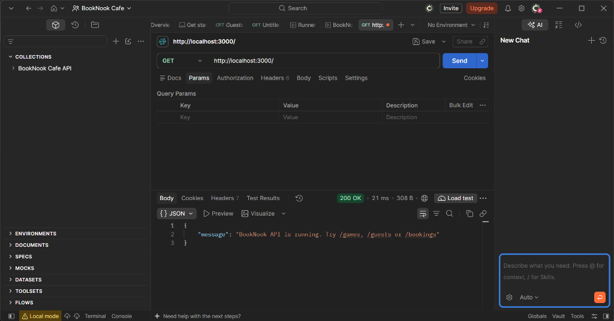

---

### Member 2: C.H Venu (@challavenu22-lang) — Database & Queries
#### Screenshot 2: All Guests from Database
`GET /guests`
- **Expected result:** `200 OK` — Returns all seeded guests.

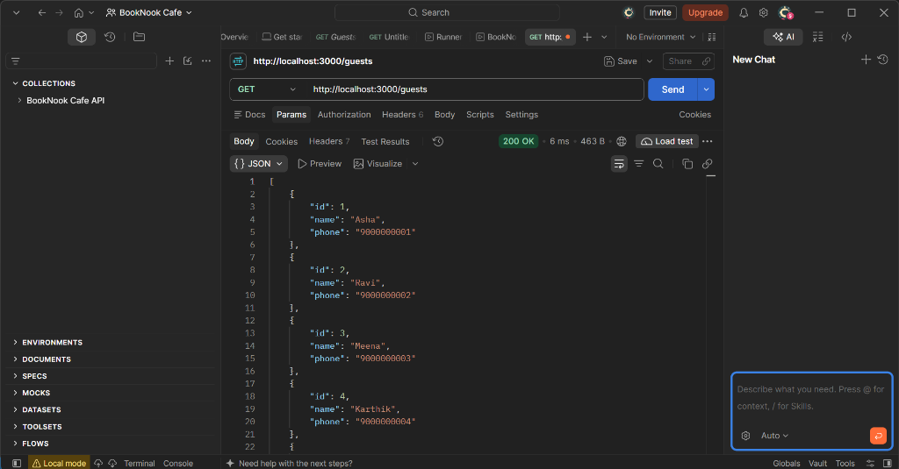

#### Screenshot 3: All Games from Database (with in_use count)
`GET /games`
- **Expected result:** `200 OK` — Returns all seeded games with real-time `in_use` status.

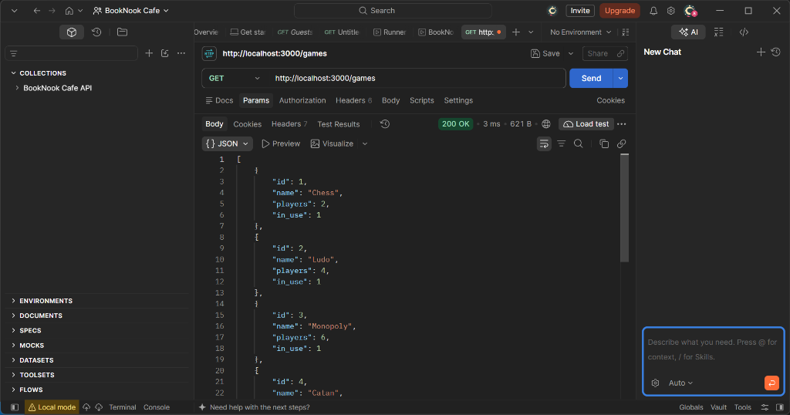

---

### Member 3: K.Kesav (@kesavkolla6-art) — REST Endpoints & JOIN Query
#### Screenshot 4: Get Guest by ID
`GET /guests/1`
- **Expected result:** `200 OK` — Returns guest record for Asha.

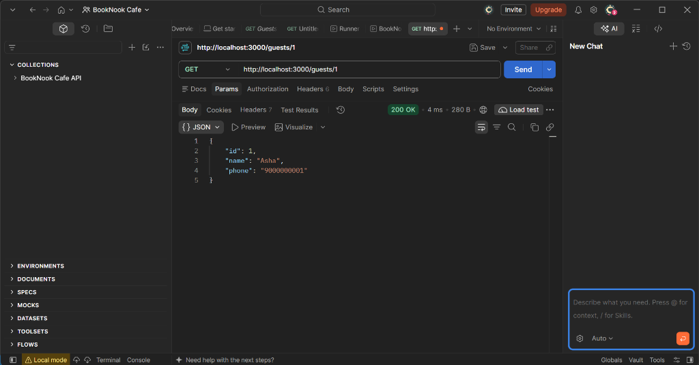

#### Screenshot 5: Add a New Guest
`POST /guests`
- **Expected result:** `201 Created` — `{"message": "Guest Added Successfully", "guestId": 6}`

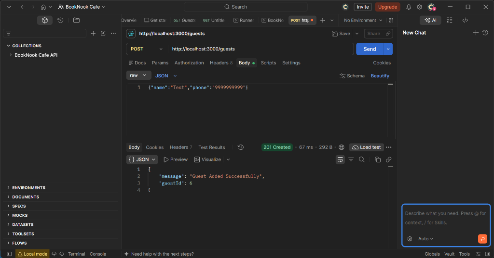

#### Screenshot 6: Bookings JOIN Query (Guest & Game details)
`GET /bookings`
- **Expected result:** `200 OK` — Returns booking records with joined `guest_name` and `game_name`.

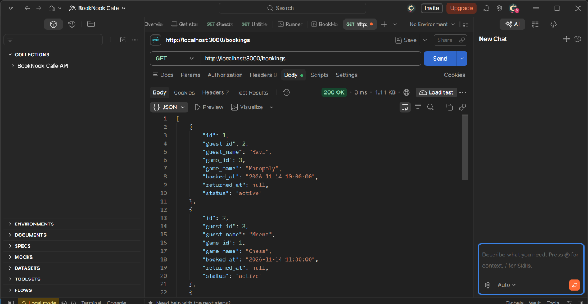

---

### Member 4: Nikitha (@gnikithaa1984-beep) — Validation & Search Filters
#### Screenshot 7: Search Games by Player Count
`GET /games?players=4`
- **Expected result:** `200 OK` — Returns only games suitable for 4 players.

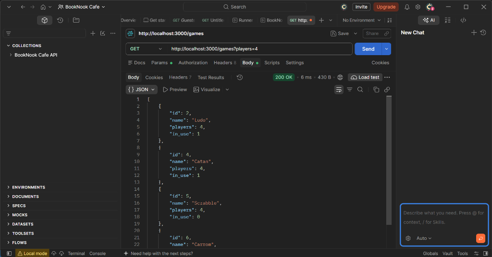

#### Screenshot 8: Search Games by Name
`GET /games?search_q=ch`
- **Expected result:** `200 OK` — Returns games matching query string.

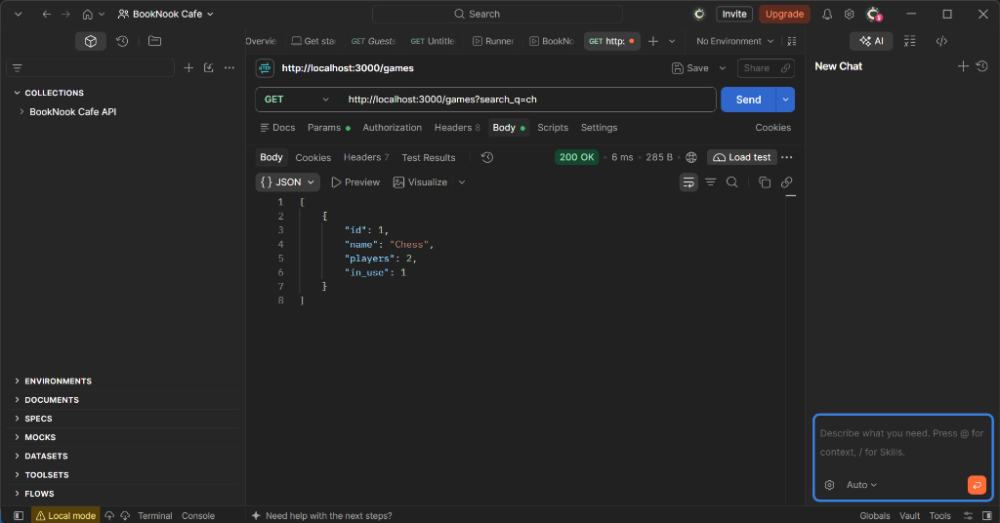

#### Screenshot 9: Filter Games by Active Status
`GET /games?in_use=true`
- **Expected result:** `200 OK` — Returns games currently checked out.

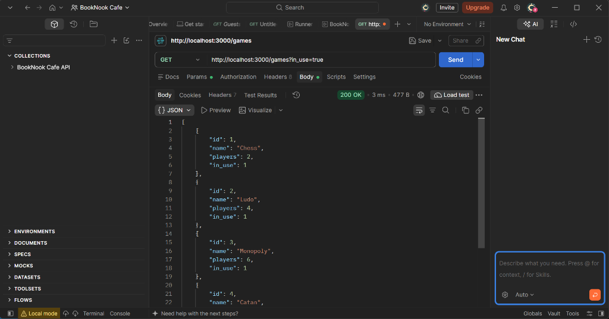

#### Screenshot 10: Validation Error Handling
`POST /guests` with `{}`
- **Expected result:** `400 Bad Request` — `{"message": "name is required and must be a non-empty string"}`

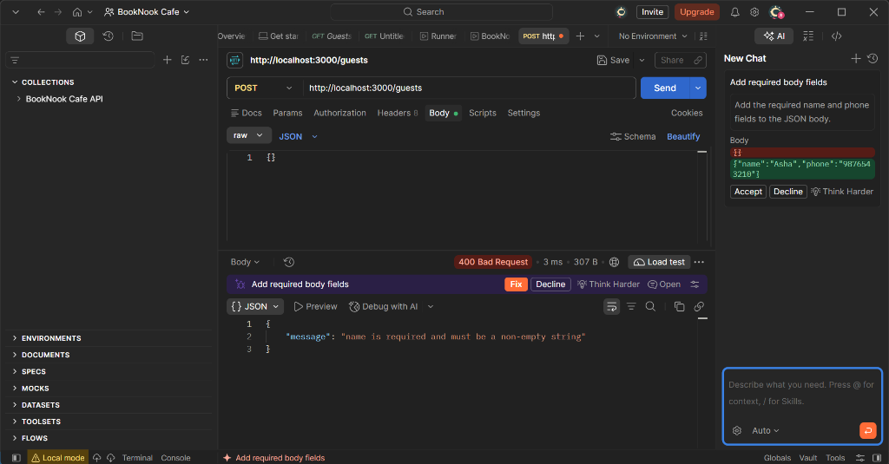

---

### Member 5: Dharani (@gudipudidharanisree-gen) — Twist Rule: Limit of 3 & Return Flow
#### Screenshot 11: Twist Rule — Limit of 3 Active Bookings
`POST /bookings` with `{"guest_id": 1, "game_id": 7}`
- **Expected result:** `409 Conflict` — `{"message": "Limit of 3 reached"}`

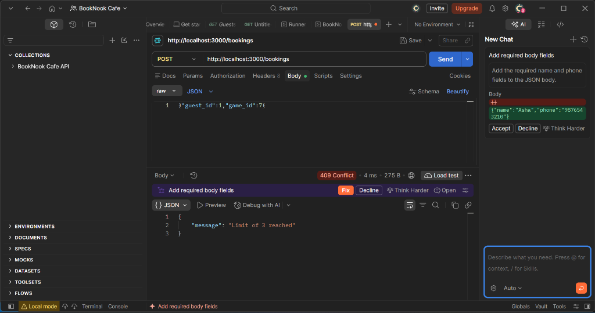

#### Screenshot 12: Twist Rule — Return Game to Free Slot
`POST /bookings/4/return`
- **Expected result:** `200 OK` — `{"message": "Game Returned Successfully", "booking": { ... "status": "returned" }}`

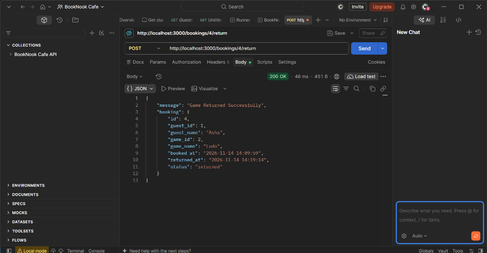

---

### Member 6: K. Monica Ashmitha (Postman Collection & Verification)
#### Screenshot 13: Postman Collection Test Results
`Collection Runner (38 requests, 42 tests)`
- **Expected result:** All 42 checks passed, 0 failed.

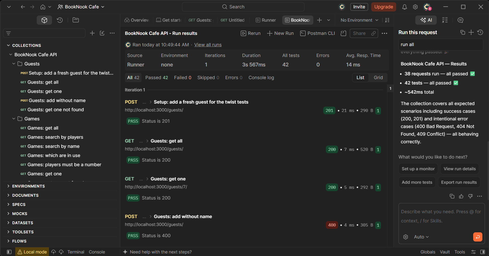

## 10. Postman Collection

The Postman collection contains 38 requests covering different API functionalities.

The requests are organized into the following categories:

- Guests
- Games (CRUD, validation and search)
- Bookings, JOIN and the limit of 3 (Tests 1 to 3, return flow)

The collection file is available at:

`postman/BookNook.postman_collection.json`

The collection uses the following variable:

| Variable | Value |
| -------- | ----- |
| baseUrl | http://localhost:3000 |

To run it: import the file in Postman, start the server, open the collection and click **Run**. A setup request adds a fresh guest, so it can be run again and again.

## 11. Project Structure

```
BookNook Cafe/
│
├── routes/
│   ├── guests.js
│   ├── games.js
│   └── bookings.js
├── app.js
├── database.js
├── validators.js
├── utils.js
├── schema.sql
├── seed.sql
├── seed.js
├── booknook.db
├── package.json
│
├── screenshots/
│   ├── 01_Server_Running.png
│   ├── 02_Database_All_Guests.png
│   ├── 03_Database_All_Games.png
│   ├── 04_Get_Guest_By_ID.png
│   ├── 05_Add_Guest.png
│   ├── 06_Bookings_Join_Query.png
│   ├── 07_Search_Games_By_Players.png
│   ├── 08_Search_Games_By_Name.png
│   ├── 09_Filter_Games_In_Use.png
│   ├── 10_Validation_Error_Handling.png
│   ├── 11_Twist_Limit_Of_3_Active_Bookings.png
│   ├── 12_Twist_Return_Game_Flow.png
│   └── 13_Postman_Test_Results.png
│
└── README.md
```

## 12. Conclusion

The BookNook Cafe: Board Games API provides a simple way to manage guests, games and bookings. It supports CRUD operations, validation, search and JOIN queries. The limit of 3 active bookings per guest, with a return flow that frees a place, lets the cafe see which games are in use and who has them. All API functionalities were tested using Postman.
